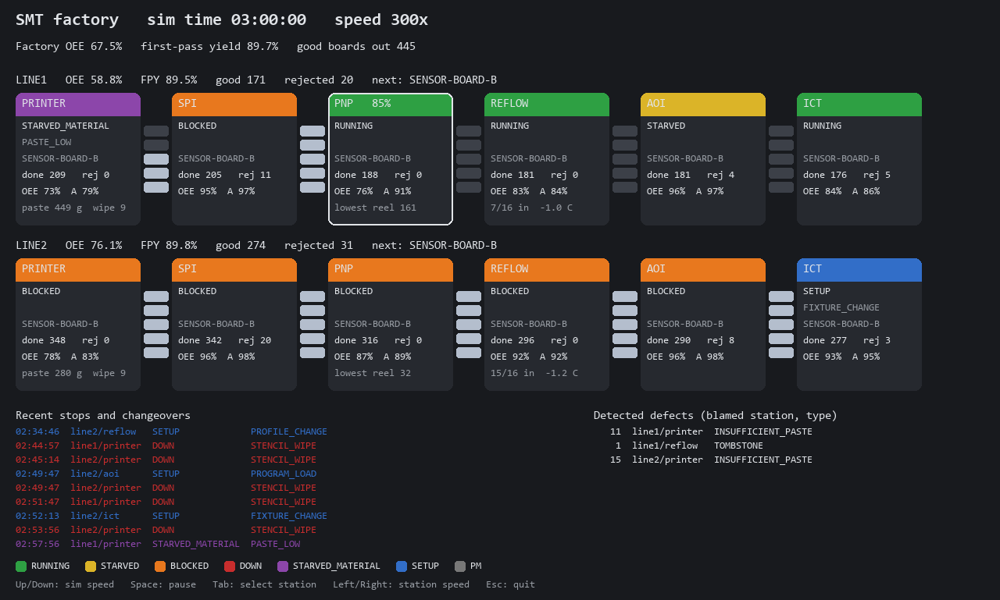
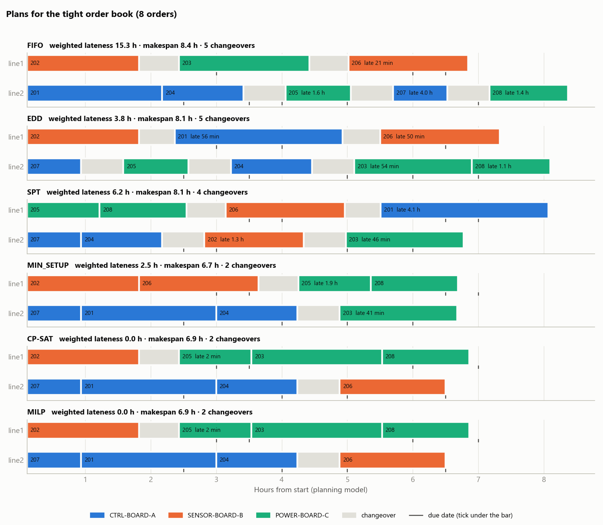
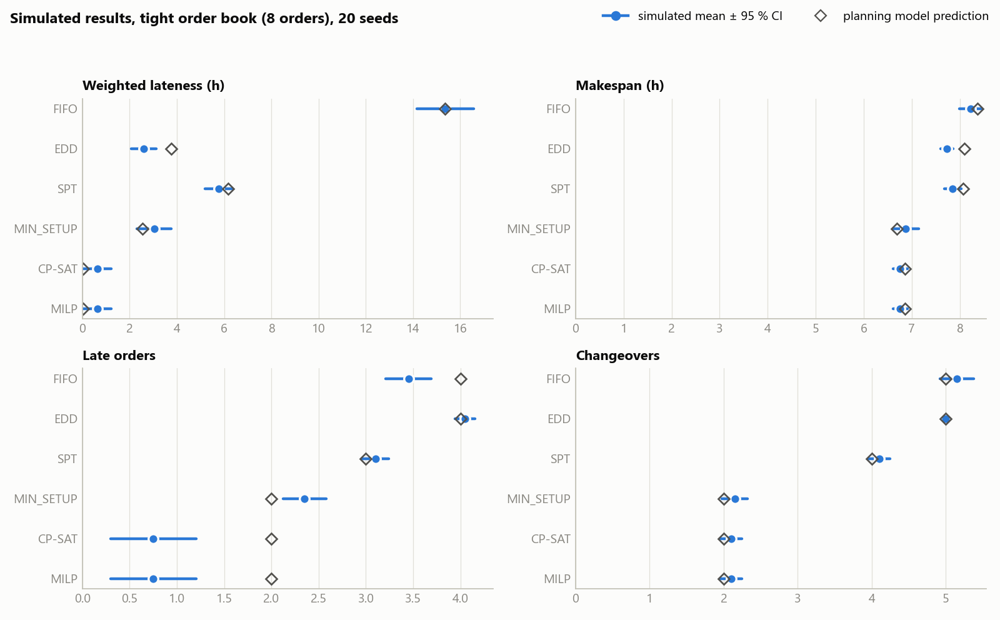
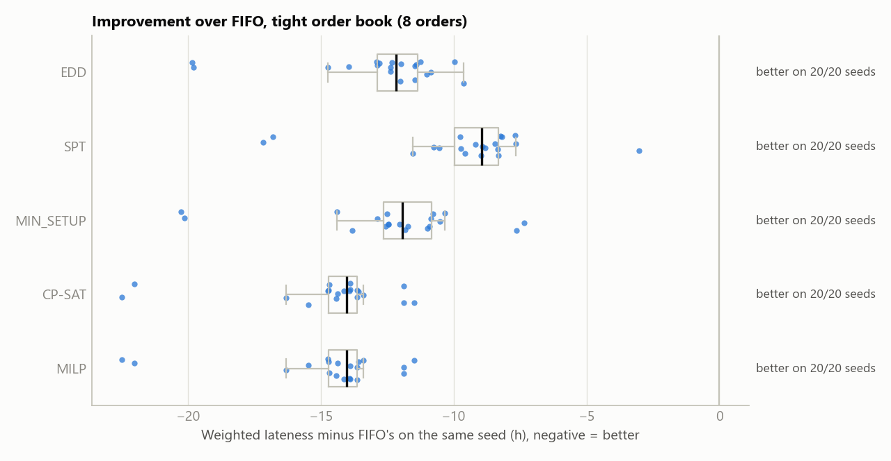
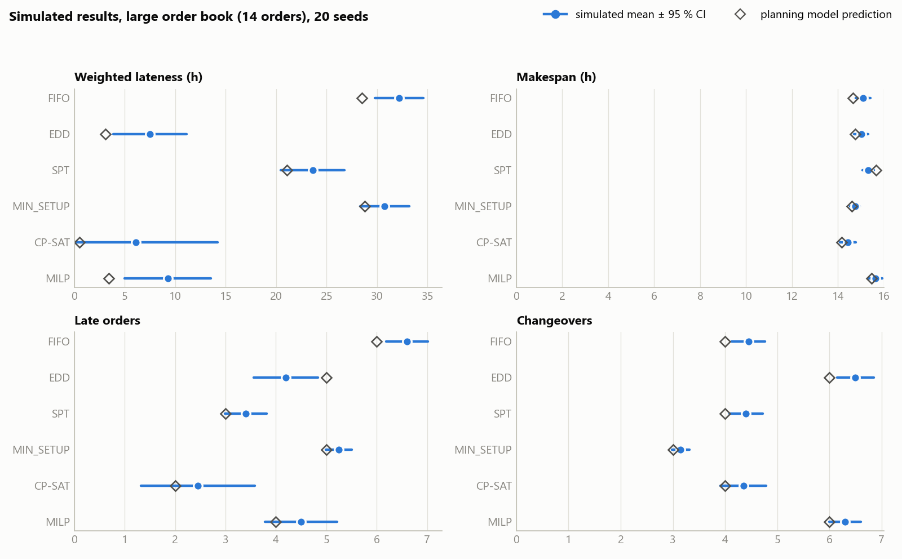
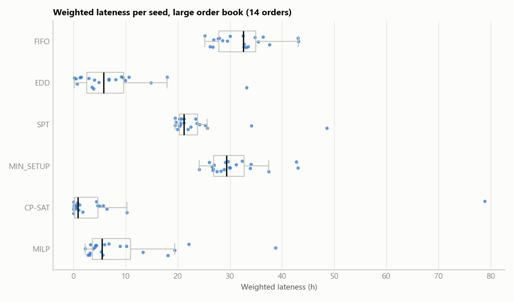
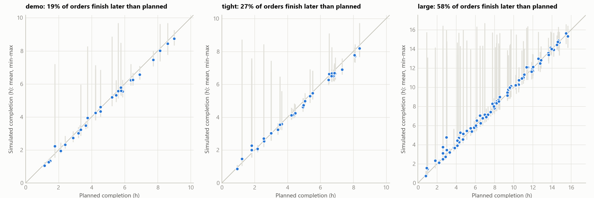
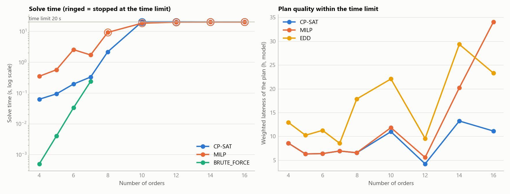

# SMT Line Simulator and Production Planning Study

Surface-mount technology (SMT) assembly is the process used to build most modern printed circuit boards, and a typical line chains six machines together: a stencil printer, a solder paste inspection station, a pick-and-place machine, a reflow oven and two test stations. This repository contains a tick-based Python simulator of such a line, together with a production planning study built on top of it. The simulator models the machines, their consumables, wear, breakdowns and defects closely enough that the usual shop-floor metrics—OEE (Overall Equipment Effectiveness), first-pass yield and downtime Pareto—behave the way they do on a real line. The planning study then uses the simulator as a test bench: it compares simple dispatching rules against exact optimisation methods on realistic order books, and measures how much of each method's advantage survives once breakdowns, empty feeders and rejected boards are part of the picture.



*The pygame view of the two-line factory at 3 h of simulated time. Each station is coloured by its state, the stacks between stations are the buffers, and line 1's pick-and-place has been slowed to 85 % from the keyboard.*

---

## 1. What this repository contains

The codebase serves two projects. They share the simulator, but each has a different goal:

- **SMT line simulator (phase 1 of an IIoT project):** The simulator is the data source for a larger IIoT (Industrial Internet of Things) project, which will measure OEE on a line and trace each loss to its root cause. Later phases of that project add OPC UA tags, a Node-RED edge gateway, MQTT over TLS to a cloud time-series database, and a web dashboard. The simulator was therefore designed so these layers can attach to it later: it exposes a flat tag snapshot, writes every state change to an event log, and exports board records to CSV.
- **Production planning study (my own project):** This is a separate study of my own. Given an order book of the form "n boards of product A, m of B and o of C, each with a due date", it asks which planning method gives the best delivery performance, and whether an optimiser's plan still wins once the line misbehaves. It lives in the `planning/` package, and the simulator core never imports it or its solver library.

## 2. The problems being solved

### 2.1 IIoT project: measuring OEE and tracing losses to a cause

An OEE figure on its own says little. A line running at 60 % OEE could be losing time to breakdowns, to slow running, to rejects, or simply to waiting on a neighbouring machine, and each of these needs a different fix. Unfortunately, a monitoring stack that claims to tell these apart is hard to validate on a real line, because the true cause of a loss is rarely known. The simulator addresses this by keeping **ground truth separate from observation**: every board carries its true defects (for example "misplacement caused by nozzle 1 while clogged") and, separately, records what each inspection station detected and which station it blamed. A dashboard's conclusions can therefore be checked against what really happened, which no real line can offer.

### 2.2 Planning study: scheduling an order book across two lines

Most SMT factories still plan with simple rules such as first-in-first-out (FIFO) or earliest-due-date (EDD), while textbooks recommend integer programming or constraint programming. Comparing the two on paper is easy, but it is also misleading, because a plan is only as good as its execution. This study therefore builds plans with six methods, simulates each plan on the same 20 random seeds, and compares the delivery performance that was actually achieved rather than only the planned figure.

## 3. The simulated line

```
Stencil Printer -> [buf] -> SPI -> [buf] -> Pick-and-Place -> [buf] -> Reflow Oven -> [buf] -> AOI -> [buf] -> ICT
```

Rather than using a discrete-event library such as SimPy, the simulator is deliberately tick-based, so that it can later stream its state in real time to the IIoT layers. The line runs in fixed 0.5 s ticks, and stations are updated from downstream to upstream so that a slot freed in a buffer can be used upstream in the same tick. Buffers hold five boards, so a stoppage spreads: downstream stations go STARVED and upstream stations go BLOCKED. Although a tick loop is less efficient than jumping from one event to the next, the simulation still runs headless at roughly 30,000 times real time, which is fast enough for experiments over many seeds.

The modelling follows four rules throughout:

- **Randomness lives in physical quantities, not in defect decisions:** A defect is never a dice roll. Stencil clogging, stencil wear and paste drying reduce the paste volume on each pad, nozzle wear and clogs widen the placement offset, and a drifting oven zone moves the peak temperature. A defect exists only when that measured quantity is out of specification, and every defect record carries its cause.
- **Normal noise for continuous quantities, hazard rates for discrete events:** Cycle times, paste volumes and offsets use normal noise. Breakdowns use exponential (random) or Weibull (wear-out) time-to-failure, and repair times are lognormal.
- **Determinism:** A single seeded random generator is passed to every component, so the same seed and configuration always give an identical run. This is what allows a fair comparison between planning methods (Section 6).
- **Everything in YAML:** Cycle times, failure rates, feeder parts, changeover times and inspection rates are all kept in `config/default.yaml`, so none of them are hard-coded and any of them can be tuned without touching the code.

| Station | What is modelled |
|---|---|
| Stencil printer | Paste consumption and refills, wipe every 10 prints, aperture clogging, stencil wear, paste drying; one stencil per product |
| SPI (solder paste inspection) | Re-measures paste volume with noise and rejects pads outside 70-130 % |
| Pick-and-place | 12 feeder slots with reels and splicing, round-robin nozzles with a Weibull clog model, placement offsets, mispicks, head speed setting |
| Reflow oven | A 16-board conveyor pipeline, drifting peak-zone temperature, cold joints, voids and tombstones |
| AOI (automated optical inspection) | Imperfect detection per defect type, plus false calls |
| ICT (in-circuit test) | Catches electrical defects that AOI missed, with a fixture changeover per product |

Three products share the line: a 120-part control board, a 104-part sensor board and a 96-part power board. Each station changes over when the first board of a new product reaches it, so a product change ripples down the line rather than stopping it all at once. A second line, configured in `config/factory.yaml`, has a faster placement machine; as a result, its bottleneck moves from the pick-and-place to the ICT station.

## 4. Getting started

Python 3.11 or newer is required. The dependencies are installed and the test suite is run with:

```bash
pip install -r requirements.txt
python -m pytest
```

The suite contains 131 tests, grouped by milestone, and takes approximately two minutes. The main entry points are listed below.

```bash
python scripts/run_headless.py --hours 24                        # one line, full metrics report
python scripts/run_headless.py --factory --hours 24              # both lines
python scripts/run_headless.py --scenario nozzle_fault --seed 1  # an injected fault (add --baseline to compare)
python viz/pygame_view.py --factory                              # live view of both lines
python scripts/calibrate_planning_model.py                       # re-measure the planning model (about 35 s)
python scripts/compare_planners.py                               # planning comparison, charts in out/planning/
python scripts/compare_planners.py --scaling --time-limit 20     # solver time against number of orders
```

In the viewer, Up/Down changes the simulation speed from 1x to 3600x, Space pauses, Tab selects a station, and Left/Right changes that station's speed.

## 5. Simulator results

Over 24 simulated hours with the default three-product plan, line 1 delivers 1,445 good boards at a line OEE of 59 %. Although that figure looks low, most of the loss is planned changeover time rather than breakdowns. With a product change every 100-150 boards, the stencil, feeder, oven profile and ICT fixture changes add up to roughly 35 minutes of lost line time per switch. The active-period method identifies the pick-and-place as the bottleneck, and this is confirmed by blocked time building up upstream of it and starved time downstream.

To check that the metrics point to the right cause, three faults can be injected through the scenario files in `config/scenarios/`. Each scenario is compared with the same run without the fault (seed 1):

| Scenario | Injected fault | What the diagnosis reports | Effect against baseline |
|---|---|---|---|
| Stencil wear | Stencil wears 12x faster from 2 h | Insufficient paste, blamed on the printer | 127 paste defects instead of 55; FPY 82.7 % instead of 88.8 % |
| Feeder depletion | Low-reel calls missed, 10 min operator response | FEEDER_EMPTY is the bottleneck's largest stop | 116 min of empty-feeder stops instead of 7; 506 good boards instead of 588 |
| Nozzle fault | Nozzle 1 clogs at 30 min, lenient vision check | Misplacement, blamed on the pick-and-place | 124 misplacement rejects; FPY 66.2 % instead of 89.7 % |

In all three cases the diagnosis names the injected cause, and the ground-truth records agree. The nozzle scenario also produced a lesson I had not planned for. Nozzle 1's injected clog was caught after about 10 minutes, but nozzle 3 then clogged on its own, and the lenient vision check let it run for about 1.6 hours. Consequently, the real root cause was the lenient check rather than any one nozzle—a fault injected in one place exposed a weakness somewhere else.

## 6. Planning study

### 6.1 Approach

A planner cannot run the full simulator inside its search, so it works with a simplified **planning model** instead. Rather than guessing that model's parameters, I measured them from the simulator itself:

- **Changeover matrix:** For every pair of products on each line, deterministic runs measure how much longer "product i, then product j" takes than the two products run separately. This captures the real line-level cost of a changeover, including the way it ripples down the line.
- **Seconds per good board:** Randomised single-product runs over three seeds measure the effective pace for each product and line, including breakdowns and rejects. For example, a good control board takes 46 s on line 1 and 37 s on line 2.
- **First-pass yield:** This is measured from the same runs and used as a planned scrap allowance, so each lot releases a few extra boards up front. Doing so avoids most top-up lots, which would otherwise have to be remade after the line's last planned lot.

Six methods are then used to build a plan, where each order becomes one lot on one line:

- **FIFO, EDD and SPT:** These are classic dispatching rules that fix the order in which jobs are considered. Each job then goes to the line on which it would finish earliest.
- **MIN_SETUP:** Whenever a line becomes free, it takes the waiting job with the cheapest changeover from its last product.
- **CP-SAT:** Google OR-Tools' constraint programming solver is used with a circuit constraint per line, which is the standard way to handle sequence-dependent changeovers in CP-SAT.
- **MILP:** A mixed-integer linear program with big-M sequencing constraints is solved with SCIP. It is the "textbook" formulation, and it serves as a point of comparison for CP-SAT.

Both exact methods minimise weighted tardiness first and makespan second. To confirm that they are correct, both were checked against a brute-force search of every possible plan, and on every order book with up to seven orders they return the same objective value.

Each plan is then run in the simulator on the **same 20 seeds** (common random numbers), so every method faces broadly the same breakdowns. This removes most of the seed-to-seed noise from the comparison. The match is not exact, however, because two plans that do different things draw different random numbers.

### 6.2 Results

Three order books are used: `demo` (6 orders, loose due dates), `tight` (8 orders with conflicting due dates) and `large` (14 orders). The table summarises weighted tardiness: for each order, the hours it finishes after its due date (zero if it is on time), multiplied by the order's weight and summed over all orders.

| Method | Tight: planned | Tight: simulated (95 % CI) | Large: planned | Large: simulated (95 % CI) |
|---|---|---|---|---|
| FIFO | 15.3 h | 15.4 ± 1.2 h | 28.5 h | 32.2 ± 2.4 h |
| EDD | 3.8 h | 2.6 ± 0.5 h | 3.1 h | 7.5 ± 3.6 h |
| SPT | 6.2 h | 5.8 ± 0.6 h | 21.1 h | 23.6 ± 3.2 h |
| MIN_SETUP | 2.5 h | 3.0 ± 0.7 h | 28.8 h | 30.8 ± 2.4 h |
| CP-SAT | 0.04 h (optimal, 0.3 s) | 0.6 ± 0.6 h | 0.49 h (30 s limit) | 6.1 ± 8.1 h |
| MILP | 0.04 h (optimal, 0.5 s) | 0.6 ± 0.6 h | 3.40 h (30 s limit) | 9.3 ± 4.3 h |

On the tight order book, the optimisers find a plan that is late by only a few minutes on paper. As the Gantt chart below shows, each line runs one product family, with only two changeovers in total. In the simulator that plan remains the best, at 0.6 h of weighted tardiness against 15.4 h for FIFO.





Because every method is run on the same seeds, each method can be compared with FIFO seed by seed. On the tight order book, every method beats FIFO on all 20 seeds, and the two optimisers improve on it by about 14 hours of weighted tardiness.



The large order book tells a more interesting story. On paper CP-SAT is far ahead (0.49 h against EDD's 3.1 h), but in the simulator its mean of 6.1 h overlaps with EDD's 7.5 h, and its spread is much wider. The distribution chart shows why: most seeds stay close to the plan, but a few go badly wrong. For the same reason, CP-SAT's interval of ± 8.1 h should be read with care. The per-seed results are strongly skewed, so a symmetric interval reaches below zero, which is impossible for tardiness; the spread chart is a better guide to how the method actually behaves.





The planning model itself is accurate on average, since the mean simulated completion times sit on the diagonal. The long upper tails come mainly from **top-up lots**. When rejects for an order are found after its lot has finished, the missing boards are remade after the line's last planned lot, so a nearly finished order can end up waiting until the end of the shift.



Finally, the scaling study shows where exact optimisation stops being practical. Up to seven orders, all three exact methods (CP-SAT, MILP and brute force) find the same optimum, with CP-SAT taking under 0.4 s. From ten orders onward, both solvers reach the 20 s time limit without proving optimality. While CP-SAT keeps finding good plans, the MILP falls behind, and at 16 orders its plan is worse than plain EDD.



### 6.3 Findings

- **The number of changeovers matters more than their order:** A changeover costs between 33 and 39 minutes of line time whichever products are involved, because the stencil, oven profile and ICT fixture changes dominate. Good plans therefore group same-product orders rather than fine-tuning the sequence.
- **Optimisation pays off when due dates conflict:** On the tight order book, CP-SAT and MILP reduce weighted tardiness in the simulator from 15.4 h (FIFO) and 2.6 h (EDD) to 0.6 h, and they do so on every seed.
- **A plan with no slack is fragile:** On the large order book, the optimiser's six-fold advantage on paper shrinks to an overlapping confidence interval in simulation. The tightest plan leaves no room for a long breakdown or a top-up lot.
- **CP-SAT scales far better than the big-M MILP:** Both are exact on small problems. Once the time limit binds, however, the MILP's weak linear relaxation leaves it behind a simple dispatching rule.
- **Time-limited solver results are not fully reproducible:** When a solver stops at its time limit, its multi-threaded search can return a different plan on each run, and the solvers use one worker per CPU core by default. The large order book's optimiser figures therefore vary slightly between runs and between machines, while the figures for problems solved to optimality do not change.

## 7. Limitations and future work

The simulator is a model, not a digital twin of a specific factory, and its parameters are plausible placeholders rather than measured values. While this rules out any claim about absolute OEE or yield figures, the relationships between causes and effects are what the IIoT project and the planning study rely on, and those relationships are tested explicitly.

### 7.1 Re-planning after disruptions

The plan is currently made once at the start of the shift, so a long breakdown or a missed reel is absorbed by whatever order happens to be next. The next step is to re-optimise the remaining orders when such a disruption happens, and to compare "plan once" against "re-plan on disruption".

### 7.2 Top-up placement

Top-up lots currently run at the end of a line's plan, which is the main source of the long tails in Section 6.2. Inserting them at the next lot of the same product, or keeping a small safety allowance, should remove most of these tails.

### 7.3 Robust planning

The optimisers plan with average paces, which is why their tightest plans break down under bad seeds. Planning with a buffer on each due date, or optimising over several sampled scenarios, would trade a little planned performance for a much smaller spread.

### 7.4 Shared resources between lines

The two lines currently share nothing, which makes the factory model simpler than a real one. A single operator serving both lines, or one order book dispatched across lines in real time, would make it more realistic.

### 7.5 Lot splitting

Each order is currently run as one lot, which limits how early an urgent order can start. Allowing an order to be split would give the optimisers more freedom.

### 7.6 IIoT layers

The flat tags, event log and CSV exports are ready for the next phases of the IIoT project: OPC UA, the Node-RED gateway, MQTT to the cloud and the dashboard.

## 8. Repository layout

```
config/
  default.yaml            line, products, stations, consumables, failures, inspection
  factory.yaml            two lines: base config plus per-line overrides
  scenarios/              stencil_wear, feeder_depletion, nozzle_fault
  orders/                 demo, tight and large order books
  planning_model.yaml     calibrated planning model (generated)
smt_sim/                  the simulator core (no pygame, no OR-Tools)
  sim.py, station.py, stations/, components.py, failures.py, defects.py,
  metrics.py, events.py, orders.py, factory.py, scenarios.py, export.py
planning/                 the planning study: model, rules, CP-SAT, MILP, evaluation, charts
viz/pygame_view.py        live view of one line or the factory
scripts/                  headless runner, calibration, planner comparison
tests/                    131 tests, grouped by milestone
docs/figures/             the charts used in this README
```

`CLAUDE.md` records the design rules and the milestone history of the project in more detail.
